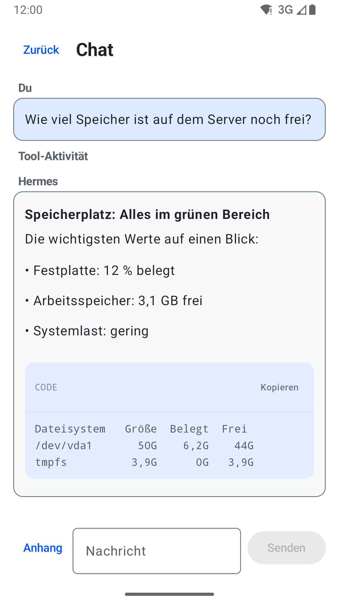
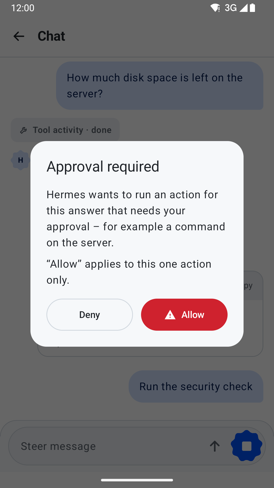
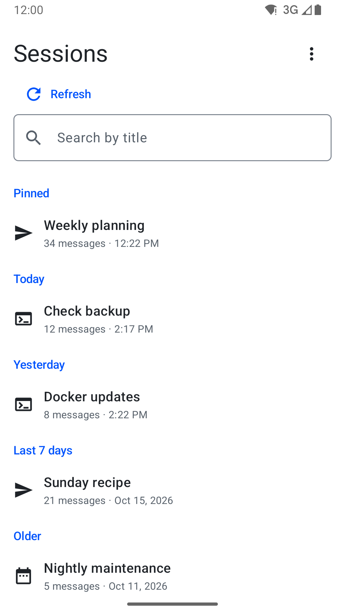
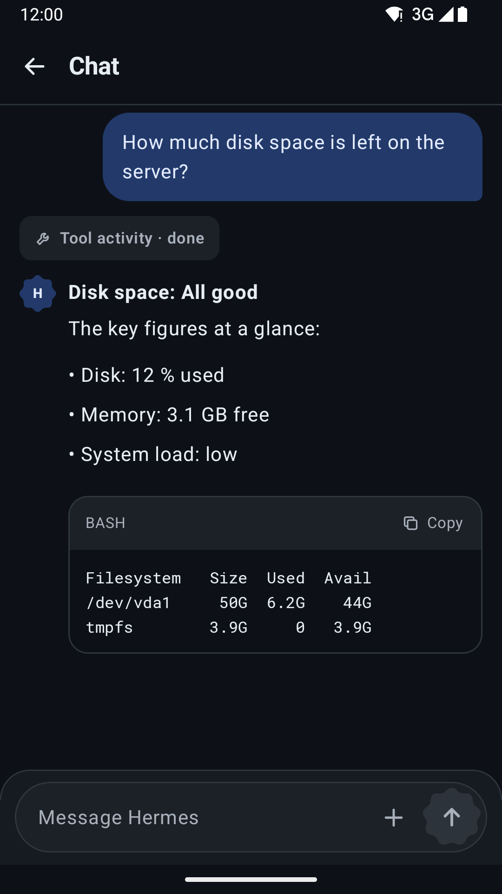
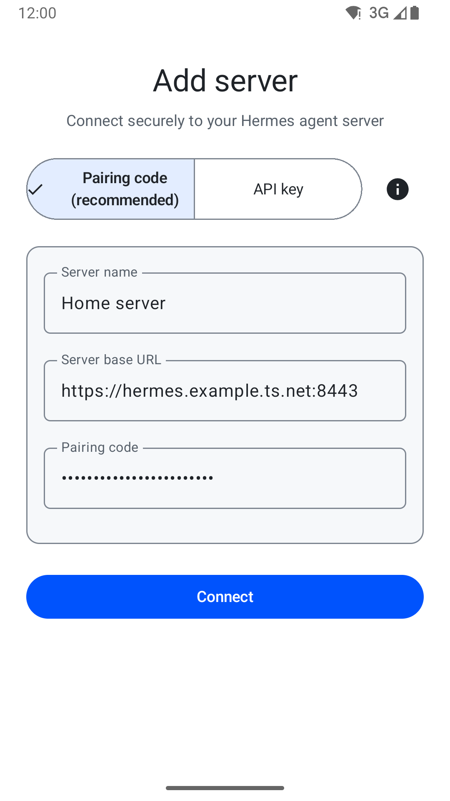

# Orsik Relay

**Your self-hosted Hermes Agent, safely in your pocket.**

[](https://github.com/exclude-barrier/OrsikRelay/actions/workflows/android.yml)
[](https://github.com/exclude-barrier/OrsikRelay/actions/workflows/bridge.yml)
[](LICENSE)

Orsik Relay is a native Android client for [Hermes Agent](https://github.com/NousResearch/hermes-agent).
Chat with your agent, watch it work, stop or steer a run and answer tool
approvals from your phone – while Hermes, its API key and all privileged tools
stay on **your** server. The phone only ever holds a revocable, least-privilege
device credential and talks to a small, self-hosted **Orsik Mobile Bridge** over
your private network.

<p align="center">
  
  
  
  
</p>

*Real app screens rendered with sample data (`scripts/readme-screenshots.sh`).
The user interface is currently German.*

> **Early alpha (`0.1.0-alpha.7`).** For technical testing on your own setup.
> No Play Store build or binary release yet – [build from source](#building-from-source).
> Not affiliated with or endorsed by Nous Research.

[How it works](#how-it-works) · [Quick start](#quick-start) · [Using the app](#using-the-app) · [Limits](#compatibility-and-limits) · [Troubleshooting](#troubleshooting) · [Documentation](#documentation)

## Highlights

- **Pairing without secrets on the phone:** a single-use code (valid 300 s) or an
  `orsik://pair` deep link / QR code creates a device credential limited to
  `chat`, `runs` and `approvals`, stored with the Android Keystore and revocable
  at any time – from the server or from the phone.
- **Runs that survive real life:** streaming answers continue across network
  drops, backgrounding, rotation and even process death. A run is never
  silently re-sent; if its outcome is unknown, the app asks the server.
- **You stay in control:** stop or steer a running turn; tool approvals offer
  only **Ablehnen** (deny) or **Erlauben** (allow once).
- **Privacy by design:** tool activity is shown without commands, arguments,
  paths or output; write requests are never retried automatically; TLS
  validation and redirects are never relaxed.
- **Everyday chat:** sessions, history, Markdown with code blocks and a copy
  button, one image per turn via the system Photo Picker, persistent drafts,
  light and dark theme, large fonts and landscape keyboards.
- **Unmodified Hermes:** the bridge runs next to an official Hermes installation;
  no fork, no core patch.

## How it works

```
 Phone                         Your server
┌──────────────┐   HTTPS    ┌──────────────────────┐ loopback ┌─────────────────────────┐
│ Orsik Relay  │──────────▶ │ Orsik Mobile Bridge  │────────▶ │ official Hermes Agent   │
│ (app/)       │  private   │ (bridge/, 127.0.0.1) │          │ api_server (unmodified) │
└──────────────┘  network   └──────────────────────┘          └─────────────────────────┘
```

- **Private network only.** The bridge binds to `127.0.0.1`; HTTPS comes from
  something you already trust – Tailscale Serve, a reverse proxy in your LAN or
  WireGuard ([network options](docs/network-deployment.md)). Nothing needs to
  be exposed to the internet.
- **The API key never leaves the server.** The bridge holds it and gives each
  phone its own device token; it proxies only sessions and runs – no jobs,
  memory, cron, artifacts or administration.
- **What the bridge adds:** device pairing and revocation, protocol version
  negotiation and re-attaching to a running stream (`after_seq` replay) – the
  parts the official core does not (yet) provide for mobile clients.

## Quick start

You need an official **Hermes Agent** installation with its `api_server`, Python
≥ 3.11 and [`uv`](https://docs.astral.sh/uv/) on the server, and an Android
8.0+ phone that can reach the server privately.

**1. Install the bridge** on the Hermes host (dependencies are installed
hash-pinned from `bridge/uv.lock`):

```sh
bridge/install.sh
# edit ~/.local/orsik-mobile-bridge/bridge.env, then:
bridge/install.sh --check
```

Configuration, systemd unit, updates, backup and rollback:
[bridge installation](docs/bridge-installation.md).

**2. Set Hermes approvals to manual** in its `config.yaml`
(`approvals: mode: manual`). The core default `smart` can approve some commands
without asking; `install.sh --check` warns about it.

**3. Expose the bridge privately over HTTPS**, for example inside a tailnet:

```sh
tailscale serve --bg --https=8443 http://127.0.0.1:9842
```

**4. Create a pairing code** – a local CLI, the bridge has no HTTP admin
interface:

```sh
BRIDGE_ENV_FILE=~/.local/orsik-mobile-bridge/bridge.env \
  ~/.local/orsik-mobile-bridge/venv/bin/orsik-mobile-bridge admin pairing-code \
  --base-url https://<your-host>:8443
```

With `qrencode` installed, a QR code for the deep link is printed as well.

**5. Pair the app:** build and install it ([building from source](#building-from-source)),
open the deep link or tap **Server hinzufügen**, enter a name and the HTTPS URL,
choose **Pairing-Code** and enter the code. The app checks the connection and
the exact capability contract before it stores anything.

<p align="center">
  
</p>

## Using the app

| Task | Where |
| --- | --- |
| Add a server | **Server hinzufügen** (or open an `orsik://pair` link) |
| Switch or remove servers | **Server verwalten** |
| Disconnect this phone from a server | **Server verwalten → Gerät trennen** |
| Start a conversation | **+** (Neue Session anlegen) on the session list |
| Stop a running answer | **Stoppen** |
| Correct a running answer | type in **Kurskorrektur**, then **Steuern** |
| Answer a tool approval | **Ablehnen** (deny) or **Erlauben** (allow once) |
| Attach an image | **Anhang** in the composer (one image, ≤ 5 MiB) |
| Light / dark mode | **Darstellung** on the session list (System / Hell / Dunkel) |

On the server, `admin list-devices` and `admin revoke-device <device_id>` list
and immediately revoke paired phones.

## Compatibility and limits

- **Server:** official Hermes Agent with the Orsik Mobile Bridge. Device pairing,
  protocol negotiation and stream re-attach are not part of the official Hermes
  release, so the bridge is required until they are upstream. Tested Hermes
  core revisions: [compatibility matrix](docs/hermes-fresh-compat.md).
- **Phone:** Android 8.0 (API 26) or newer; built against API 37, targeting
  API 36. Certificates must be trusted by Android's system store – private or
  self-signed CAs are not supported.
- **Single owner:** the official core has no per-device ownership; every paired
  phone acts on behalf of the one owner across all sessions and runs
  ([threat model](docs/bridge-security.md)).
- **Attachments:** images only (JPEG, PNG, WEBP), one per turn, up to 5 MiB;
  vision depends on your model.
- **Not yet:** approvals do not show the command being approved, no voice input,
  no bot management, German UI only.

## Troubleshooting

- **„Der Server bietet nicht die benötigten Hermes-Funktionen.“** – the URL does
  not point at the bridge, or the bridge/core does not offer the Mobile v1
  contract. Use the bridge URL (port 8443 in the example above), not the Hermes
  `api_server` itself, and run `bridge/install.sh --check`.
- **„Die sichere Serververbindung konnte nicht bestätigt werden.“** – the TLS
  certificate is not trusted by Android. Use a publicly trusted certificate
  (Tailscale Serve provides one) instead of a self-signed CA.
- **„Der Hermes-Server ist derzeit nicht erreichbar.“** – the phone cannot reach
  the server: check VPN/tailnet, the `tailscale serve` mapping and that the
  bridge is running.
- **„Der Pairing-Code ist ungültig, abgelaufen oder bereits verwendet.“** – codes
  are single-use and expire after 300 seconds; create a new one.
- **No approval ever appears** – Hermes may be approving on its own; set
  `approvals: mode: manual`.

## Documentation

Most design documents are currently written in German.

- [Bridge installation](docs/bridge-installation.md): install, configure, update, back up and roll back the bridge.
- [Network options](docs/network-deployment.md): LAN, WireGuard and Tailscale setups.
- [Threat model](docs/bridge-security.md): trust boundaries, security properties and residual risks.
- [Mobile wire contract](docs/mobile-wire-contract.md): the versioned Mobile v1 protocol between app and bridge.
- [Architecture](docs/architecture.md): layers and run-lifecycle invariants of the app.
- [Hermes compatibility](docs/hermes-fresh-compat.md) and [live end-to-end evidence](docs/bridge-e2e.md).
- [Release](docs/release.md): signing, SBOM, provenance and branch rules. [Toolchain](docs/toolchain.md): build requirements and coverage.

## Building from source

You need JDK 17 and the Android SDK (platform 37, build tools 36.1.0);
`scripts/verify-environment.sh` checks your setup. The Gradle wrapper pins
everything else.

```sh
./gradlew :app:assembleDebug          # debug APK in app/build/outputs/apk/debug/
./gradlew :app:testDebugUnitTest      # JVM unit tests
./gradlew :app:lintDebug              # Android lint
./gradlew :app:connectedDebugAndroidTest \
  -Pandroid.testInstrumentationRunnerArguments.notAnnotation=io.github.excludebarrier.orsikrelay.CaptureOnly,io.github.excludebarrier.orsikrelay.LiveBridge
(cd bridge && uv run --locked python -m unittest discover -s tests)
```

Every pull request runs these checks plus a release build with SBOM and
checksums. Release signing is fed only from environment variables and fails
closed ([release](docs/release.md)).

## Contributing

Bug reports and focused feature requests are welcome through
[GitHub Issues](https://github.com/exclude-barrier/OrsikRelay/issues). Please read
[CONTRIBUTING.md](CONTRIBUTING.md) before opening a pull request, and report
security issues privately as described in [SECURITY.md](SECURITY.md).

## License

Apache License 2.0. See [LICENSE](LICENSE).
